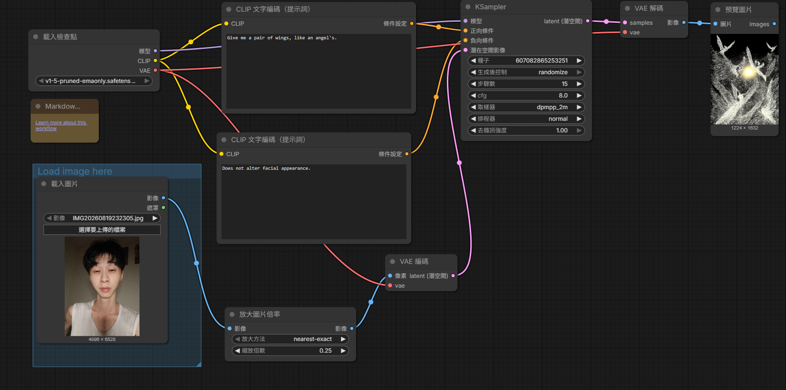

# ComfyUI 圖生圖

# 原圖

# 生成的圖

# 完整工作流截圖

# 正反提示詞

## 正面提示詞
(Give me a pair of wings, like an angel's.

## 負面提示詞
(Does not alter facial appearance.

# 5.個人心得

> 自己摸索了ComfyUI並且實際操作後，我因為不想讓畫面變得太複雜，我喜歡乾淨，所以提示詞給得很少，可能因為這個原因導致結果不符合我的預期，我嘗試了很多次重新生成，但由於不熟悉這套軟體，所以生成完圖片後再繼續生成，導致接下來的圖片都很奇怪。
